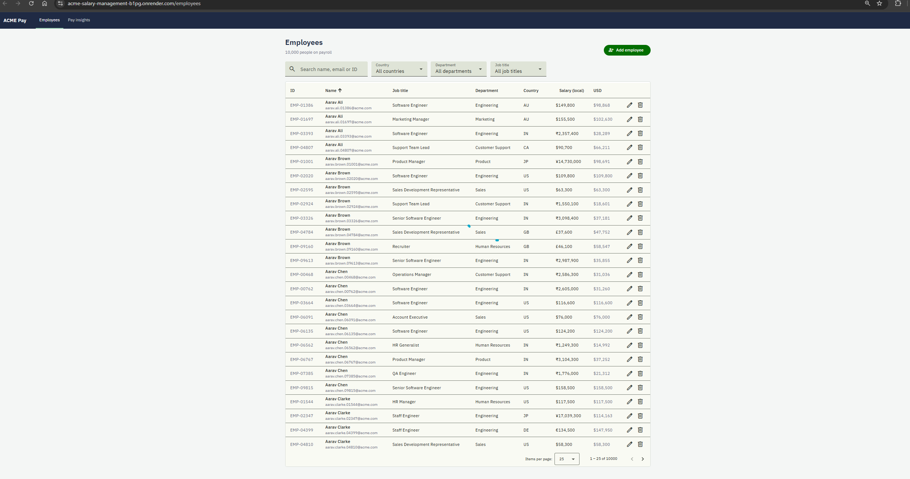
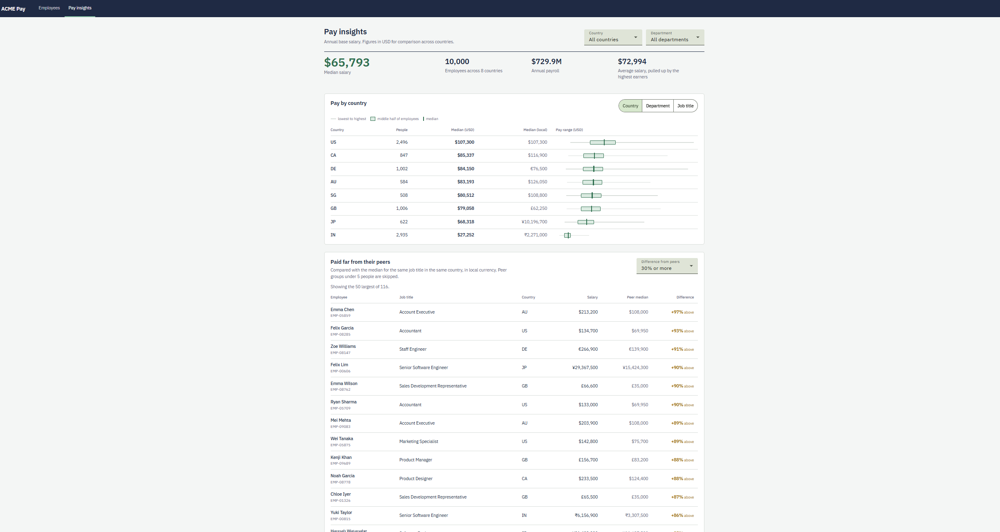

# ACME Pay: salary management for HR


A web application that replaces ACME's spreadsheet-based salary records for ~10,000 employees across 8 countries. An HR manager can maintain employee salary data and answer questions about how the organisation pays people: typical pay by country, department or role, the spread of pay within a group, and who is paid far from their peers.

- **Live app:** https://acme-salary-management-b1pg.onrender.com
  (hosted on a free tier: if the app has been idle, the first load can take up to 2 minutes while it starts)
- **Demo video:** _add link_
- **Requirements:** [docs/REQUIREMENTS.md](docs/REQUIREMENTS.md)

## What it does




**Employee directory.** Search 10,000 employees by name, email or ID, filter by country, department and job title, sort and page through results. Add, edit and delete employees with validation on both client and server. Every salary is shown in its local currency and in USD.

**Pay insights.** Headline numbers (median salary, headcount, annual payroll), salary distribution grouped by country, department or job title with a pay-range bar per group, and a list of employees paid 20/30/50%+ away from the median of their peers (same job title and country).

## Tech stack

| Layer | Choice |
|---|---|
| Backend | Java 25, Spring Boot 4, Spring Data JPA, Flyway |
| Database | PostgreSQL 16 |
| Frontend | Angular 22 (standalone components, signals), Angular Material |
| Tests | JUnit 5, Mockito, Testcontainers (backend) · Vitest (frontend) |
| Delivery | Docker (single image), Render, GitHub Actions CI |

Why these choices: [docs/DECISIONS.md](docs/DECISIONS.md).

## Running locally

**Prerequisites:** Java 25, Docker Desktop (running), Node.js 24.

```bash
# 1. Start Postgres (port 5433, so it doesn't clash with a locally installed Postgres)
docker compose up -d

# 2. Start the backend and seed 10,000 employees (seeding is skipped if data already exists)
cd backend
./mvnw spring-boot:run "-Dspring-boot.run.arguments=--app.seed.enabled=true"
#    API: http://localhost:8081/api/employees

# 3. In a second terminal, start the frontend
cd frontend
npm install
npm start
#    App: http://localhost:4200
```

On Windows Command Prompt use `mvnw` instead of `./mvnw`.

## Deployment

The app ships as a single Docker image: the [Dockerfile](Dockerfile) builds the Angular app, bundles it into the Spring Boot jar as static files, and runs it on a slim JRE as a non-root user. One service, one URL, no CORS in production.

It runs on Render (Docker web service + managed PostgreSQL), configured only through environment variables:

| Variable | Purpose |
|---|---|
| `DB_URL` | JDBC URL, e.g. `jdbc:postgresql://host:5432/db` |
| `DB_USERNAME`, `DB_PASSWORD` | Database credentials (never committed) |
| `APP_SEED_ENABLED` | `true` loads 10,000 demo employees on first start; skipped when data exists |
| `PORT` | Set by the platform |

To try the image locally against the Compose database:

```bash
docker build -t acme-pay .
docker run --rm -p 9090:8080 -e PORT=8080 --network acme-salary-management_default \
  -e DB_URL=jdbc:postgresql://postgres:5432/salary acme-pay
#    App: http://localhost:9090
```

GitHub Actions runs the backend and frontend test suites and a production build on every push.

## Running tests

```bash
cd backend && ./mvnw test           # needs Docker running (Testcontainers starts a throwaway Postgres)
cd ../frontend && npx ng test --watch=false
```

The backend suite has three levels: pure unit tests (business rules, seed generator, currency maths), web-layer tests (HTTP status codes, validation, error format) and integration tests against real Postgres (schema, constraints, search SQL, analytics SQL). Details in [docs/ARCHITECTURE.md](docs/ARCHITECTURE.md#testing-strategy).

## API overview

| Method | Path | Purpose |
|---|---|---|
| GET | `/api/employees` | Search, filter, sort, paginate (`search`, `country`, `department`, `jobTitle`, `page`, `size`, `sort`, `direction`) |
| GET | `/api/employees/{id}` | One employee |
| GET | `/api/employees/filter-options` | Distinct countries, departments, job titles |
| POST | `/api/employees` | Create |
| PUT | `/api/employees/{id}` | Update (requires `version` for optimistic locking) |
| DELETE | `/api/employees/{id}` | Delete |
| GET | `/api/insights/summary` | Headcount, payroll, median, average (USD) |
| GET | `/api/insights/salary-stats?groupBy=country\|department\|jobTitle` | Distribution per group |
| GET | `/api/insights/outliers?threshold=0.3` | Employees far from their peer median |
| GET | `/api/exchange-rates` | Supported currencies and the rate snapshot date |

Errors use RFC 9457 problem details: `{ "status": 400, "detail": "...", "errors": { "email": "..." } }`.

## Repository layout

```
backend/              Spring Boot API, organised by feature: employee/, insights/, currency/, seed/, common/
frontend/             Angular app: core/ (API services, models), employees/, insights/, shared/
docs/                 Requirements, architecture, decisions, AI usage notes
Dockerfile            Builds the UI and API into one image
docker-compose.yml    Local Postgres
.github/workflows/    CI: tests and build on every push
```

## Documentation

- [Requirements](docs/REQUIREMENTS.md): goal, scope, what was left out and why
- [Architecture](docs/ARCHITECTURE.md): components, data model, testing and performance
- [Decisions and trade-offs](docs/DECISIONS.md)
- [How AI was used](docs/AI_USAGE.md)
