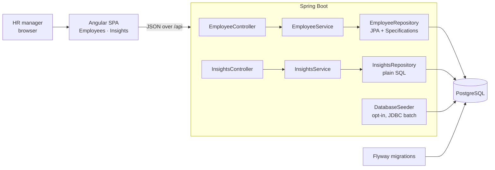
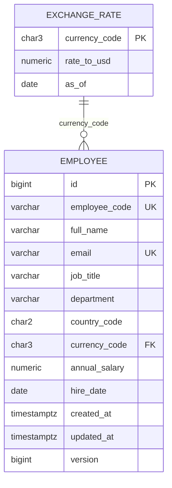

# Architecture

## Overview

The backend is organised **by feature** (`employee`, `insights`, `currency`, `seed`, `common`) rather than by layer, so everything about one capability lives together. Within a feature, controllers handle HTTP only, services hold business rules, and repositories talk to the database.

## Data model

- **Salary is stored in local currency** (`NUMERIC(14,2)`, never floating point). It is the number HR entered and is never altered. USD values are computed at read time.
- **Exchange rates are a static snapshot** loaded by a migration, so every environment has them and analytics are reproducible.
- **`version`** enables optimistic locking: if two people edit the same employee, the second save is rejected with 409 instead of silently overwriting.
- **Database constraints back up application validation**: unique email and employee code, positive salary, and a foreign key that makes an unconvertible currency impossible.

Schema changes are versioned Flyway migrations (`V1` schema, `V2` exchange rates, `V3` indexes and a tightened salary check). Applied migrations are never edited; changes are made with new migrations.

## Two ways of reading data

| Use case | Approach | Why |
|---|---|---|
| Directory and CRUD | JPA entities + Specifications for dynamic filters | Type-safe, simple object mapping, optimistic locking for free |
| Analytics | Hand-written SQL via `NamedParameterJdbcTemplate` | Aggregation belongs in the database. Postgres `percentile_cont` gives true medians and percentiles without loading 10,000 rows into memory |

Dynamic SQL in the insights queries is limited to two things: a `GROUP BY` column chosen from an enum whitelist, and `WHERE` conditions whose values are always bind parameters.

## Frontend

- Standalone components and **signals** for state. Each page is lazy-loaded (first screen is ~91 KB transferred).
- API calls go to relative `/api` paths. In development a proxy forwards them to the backend, so no URLs are hard-coded.
- Filter and sort changes flow through `switchMap`, which cancels stale requests so an older response can never overwrite a newer one. Search input is debounced by 300 ms.
- One error helper turns every failed request into a readable message, and maps server validation errors onto the matching form fields.

## Testing strategy

| Level | Examples | Speed |
|---|---|---|
| Unit (no Spring, no DB) | `EmployeeServiceTest` (business rules with mocked repositories), `EmployeeGeneratorTest`, `ExchangeRateTest`, `InsightsServiceTest` | Milliseconds |
| Web layer (`@WebMvcTest`) | Controller tests: status codes, validation messages, error shape, rejecting unknown sort or group-by values | Fast |
| Integration (Testcontainers Postgres) | Repository constraints, directory search SQL, analytics SQL, seeder idempotency | Seconds |
| Frontend (Vitest) | API error mapping, query params, formatting, pay-range geometry, HTTP service contract | Fast |

Integration tests use small hand-checkable datasets. For example, five engineers where one earns far more than the rest prove that the median ignores the outlier while the average does not, and that the outlier query flags exactly that person. Every database test runs in a transaction that is rolled back, so tests are independent and order doesn't matter. The seed generator uses a fixed random seed, so its tests are deterministic too.

## Performance considerations

- **Server-side pagination, filtering and sorting**: the browser never receives more than 100 rows, and page size is capped at 100.
- **Indexes match the access patterns**: `country_code`, `department`, and `(job_title, country_code)` for directory filters, group-bys and peer groups. Only these were added because every index slows writes.
- **Aggregation in SQL**: summary, grouped stats and outliers are single queries. At 10,000 rows they return in milliseconds.
- **Seeding uses JDBC batch inserts** (1,000 rows per batch, one transaction). JPA cannot batch inserts with `IDENTITY` ids.
- **Stable pagination**: every sort has `id` as a tie-breaker so rows never repeat or disappear between pages.

**At larger scale** (for example 1M+ employees) the next steps would be: a trigram index (`pg_trgm`) for the `%term%` name search, caching or materialised views for org-wide aggregates, and keyset pagination for deep pages.
